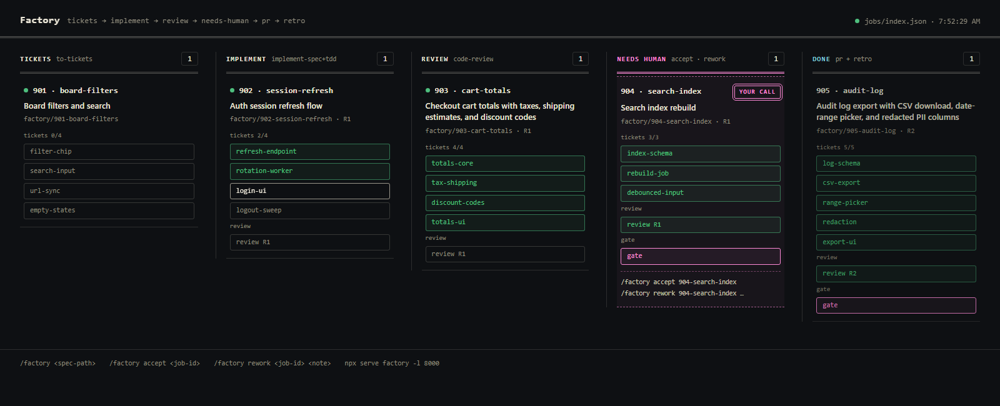

# Factory — Project Agent Factory

Local-only loop that turns a complete spec file into Done through **Matt Pocock skills**, with a static Dashboard for live status.

the host repo (`<repo>`) is untouched except by Job branches. Canon lives in `GLOSSARY.md` (Factory/Job/Stage/Agent/Dashboard/Frontier/Needs-human); orchestrator + agents live in `.agents/skills/factory/`.

Copy this folder's contents into a new workspace/repo root and run `/factory <path-to-spec.md>`.

## Dashboard



## The loop

```
spec file → to-tickets → implement-spec (frontier workers + mergers) → code-review → ESCALATE needs-human        pr → retro → done
                               ▲                                                       │                         ▲
                               └────────── /factory rework: resume implement ──────────┘─────── /factory accept ─┘
```

No approve-merge path: every Job ends at `needs-human` via `ESCALATE`, and the human owns the final merge by hand. `pr` + `retro` run only after `/factory accept`.

## Commands

Run from an opencode session at the workspace root:

```
/factory <path-to-spec.md>      start a Job from a complete spec
/factory accept <job-id>        human says yes → pr Agent, then retro Agent, then done
/factory rework <job-id> <note> human says fix → back to implement with a fresh resume budget
```

## Dashboard

```powershell
npx serve factory -l 8000
# → http://localhost:8000/dashboard.html
```

Static page, 5 columns (Tickets/Implement/Review/Needs-human/Done). Polls `jobs/index.json` + each `job.json` every 2s: ticket chips flip `pending → doing → done` with a `done/total` count, review/gate chips fill from first lines, cards in Needs-human stand out. Click a card for the file drawer (`spec.md` → tickets → `build.md` → reviews → `decision.md` → `pr.md` → `retro.md`).

## Layout

```
factory/
  README.md            this file
  GLOSSARY.md          factory canon (host project vocabulary untouched)
  dashboard.html       static board (dark, factory-owned theme)
  jobs/index.json      manifest of job ids (orchestrator-maintained)
  jobs/<job-id>/
    job.json           live state (orchestrator sole writer — Dashboard reads it)
    spec.md            input spec, copied as-is
    tickets/NN-slug.md tracer tickets with blocking edges
    build.md           STATUS: READY|BLOCKED first line + validation + log
    round-N/review-code.md   VERDICT: PASS|CHANGES first line
    decision.md        always ESCALATE first line + why + for-the-human (live gate file)
    decision-N.md      archived gate from round N (one per rework)
    rework-k.md        verbatim human notes from /factory rework
    pr.md / retro.md   only after /factory accept
```

Worktrees live outside the repo at `../<name>-factory/<job-id>` (integration, branch `factory/<job-id>`, `<name>` = repo folder name) plus `../<name>-factory/<job-id>-<ticket>` per ticket. Branch + worktrees stay after the gate for inspection; the human merges and deletes them.

## Use in a new repo

1. Copy `factory/` and `.agents/` into the repo root.
2. Fill in `AGENTS.md` (setup, dev-server, check, test commands).
3. Add project glossary / design contract if the project has them.
4. Serve the board: `npx serve factory -l 8000` → `http://localhost:8000/dashboard.html`.
5. Run `/factory <path-to-spec.md>` from an opencode session at the workspace root.

## Agent / skill split

Each agent file is a Skill call plus factory wiring (~11 lines) — the skill owns the method:

| Agent | Skill |
| ----- | ----- |
| tickets | `to-tickets` |
| implementer (stage runner) | `implement-spec-factory` (own derivation: no branch creation, no PRs, no cleanup, no in-stage review) |
| merger | none — pure git mechanics |
| reviewer-code | `code-review` (+ `VERDICT` rule: PASS iff no must-fix; smell baseline kept) |
| pr | `pr` |
| retro | `retro` (factory-only patches) |

## License

Released under the [MIT License](./LICENSE). You are free to use, modify, and distribute dropnode — commercially or privately — provided the copyright notice and permission notice are preserved. Your graphs stay yours: the license covers the software, not your data.